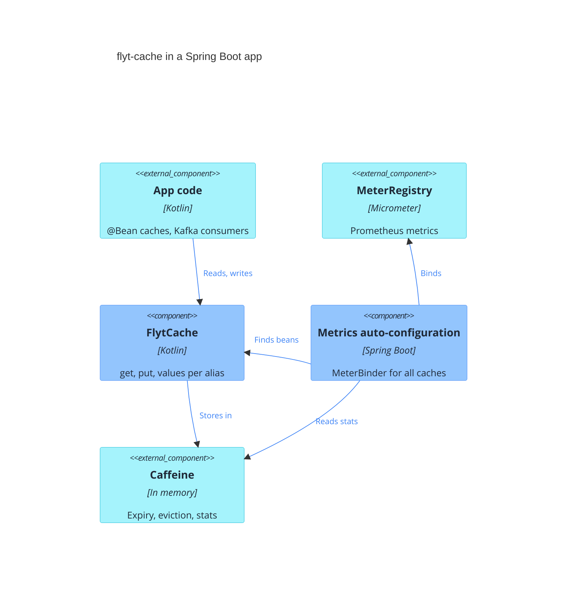

# Architecture

C4 level 3 for flyt-cache. The library has no system context or containers of its own: it runs inside each Spring Boot
app that depends on it. The diagram shows that app with the library's components. Blue is flyt-cache, turquoise is the
app, Caffeine and Micrometer.

## C4 level 3: Components

- **`FlytCache`** is a thin Kotlin API over one Caffeine cache. Entries expire a fixed time after they were last written
  (`expireAfterWrite`, 6 days by default), and Caffeine evicts the least valuable entries above `maximumSize`. Apps
  create caches in `@Bean` methods, so the metrics auto-configuration can find them.
- **`FlytCacheMetricsAutoConfiguration`** registers a `MeterBinder` when Micrometer is on the classpath. Spring Boot binds
  it to the `MeterRegistry` after all singletons are created, and it registers the standard Caffeine metrics for every
  `FlytCache` bean, tagged with `cache=<alias>`. It fails at startup if two caches share an alias.

## Use in FLYT

archive-gateway fills its own caches from the FINT API and publishes the same resources to Kafka entity topics.
acos-gateway and egrunnerverv-gateway fill their caches from those topics. archive-gateway pulls changes every 15
minutes and republishes all resources every night between 03:00 and 04:00, which renews the time to live everywhere.
The time to live is what removes resources deleted in FINT, since no tombstones are sent. It must stay longer than the
nightly republishing, and matches the 5-day retention of the entity topics.

Not in the library: loading, refreshing or persisting entries. The app writes to the cache.
